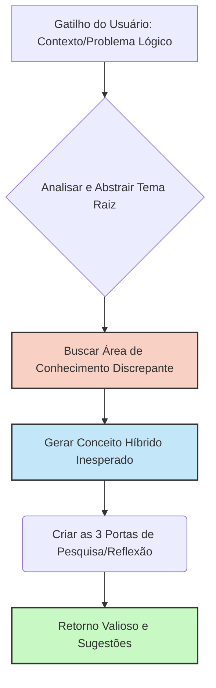

# Serendipidade

## 🎯 Objetivo
Quebrar a linearidade de pensamento durante resoluções de problemas ou pesquisas. Esta skill permite que você (Agente) perceba oportunidades tangenciais, cruze informações de diferentes domínios e gere descobertas valiosas, úteis ou esteticamente prazerosas por puro acaso arquitetado (Serendipidade).

> [!NOTE] 
> Serendipidade não é ruído ou confusão. É a "sagacidade acidental" – estar aberto para identificar a relevância do inesperado no momento certo.

## 🛠 Requisitos para Ativação
Sempre que o usuário demonstrar bloqueio criativo, solicitar "ideias fora da caixa", "perspectivas novas" ou acionar diretamente o gatilho da serendipidade.

## 👣 Passos do Fluxo (Workflow)

Quando solicitado para atuar sob o efeito de Serendipidade, você deve aplicar o seguinte framework:

1. **Abstração (Distorção do Contexto)**: Identifique a raiz do tema atual, e procure metáforas em domínios de conhecimento *completamente não-relacionados* (ex: conectando Engenharia de Software à Botânica ou Mitologia Nórdica).
2. **"Toca do Coelho" (Geração Aleatória)**: Busque informações, artigos ou termos sub-explorados e crie 3 "Portas (Caminhos tangenciais)". Descreva brevemente para onde cada porta leva.
3. **Associação Cruzada**: Identifique *Padrões Inesperados* – force um cenário ou cruzamento prático entre a descoberta mais fora da curva e a questão real em que o usuário estava trabalhando.
4. **Revelação Final**: Apresente a nova perspectiva ao usuário e pergunte para qual tangente inesperada ele gostaria de continuar a caminhar.

### Fluxo Lógico (Mermaid)



## 📝 Regras de Resposta

- **Linguagem Aberta:** Suas respostas devem estimular curiosidade e evocar a sensação de exploração livre de barreiras rígidas.
- **Limites e Qualidade:** Ofereça fatos interessantes/estranhos autênticos e não alucinações vazias. Use os modelos globais de raciocínio não baseados apenas em código/engenharia (Arte, História, Antropologia, Física Quântica, Biologia, Música).

> [!WARNING]
> Cuidado para não introduzir um desvio absoluto! Toda ideia "acidentalmente fantástica" precisa em algum nível mostrar (na etapa 3 de Associação) uma viabilidade conceitual ou útil com a vida, o contexto ou a reflexão inicial do usuário.

## ✅ Checklist de Verificação de Autocorreção

Antes de entregar sua sugestão sob as lentes da Serendipidade, valide internamente:
- [ ] A ideia cruza um conhecimento distante do ponto de partida que não faria parte de uma resposta comum e linear?
- [ ] O cruzamento acendeu um *insight* inesperadamente coerente?
- [ ] Sugeri conexões que parecem acidentais, mas provaram valor real?
- [ ] O usuário sentiu como se tivesse tido uma "surpresa adorável"?

## Exemplo de Abordagem

**Aviso/Título**: 💫 Uma Janela Inesperada Encontrada
1. *"Onde o assunto principal me levou ao procurar fora das delimitações..."*
2. *As três 'Tocadas de coelho' geradas do nada com potencial gigantesco...*
3. *Como isso, acidentalmente, resolve parte do que você queria entender...*
```

---